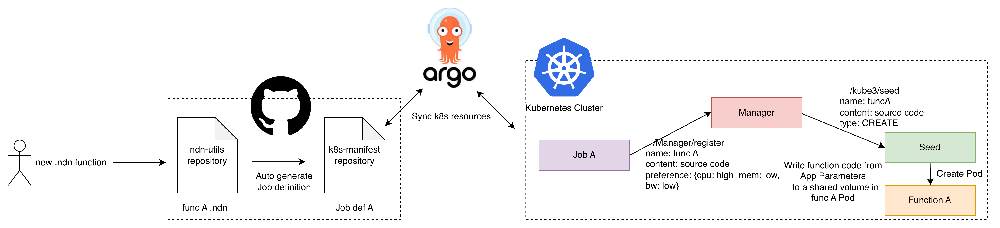
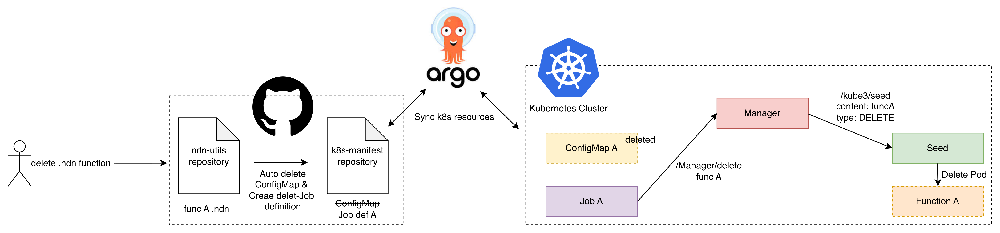
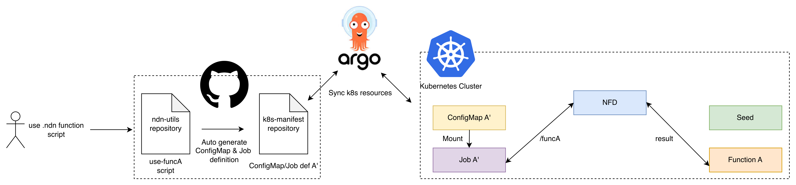

## Register New Function


Place function source files in `ndn-scripts/func/` and their registration
definitions in `ndn-scripts/yaml/`. `function.source` is the filename in
`ndn-scripts/func/`.

```yaml
function:
  name: ten_x
  runtime: python
  source: ten_x.py
```

## Delete Existing Function


## Use Existing Function

